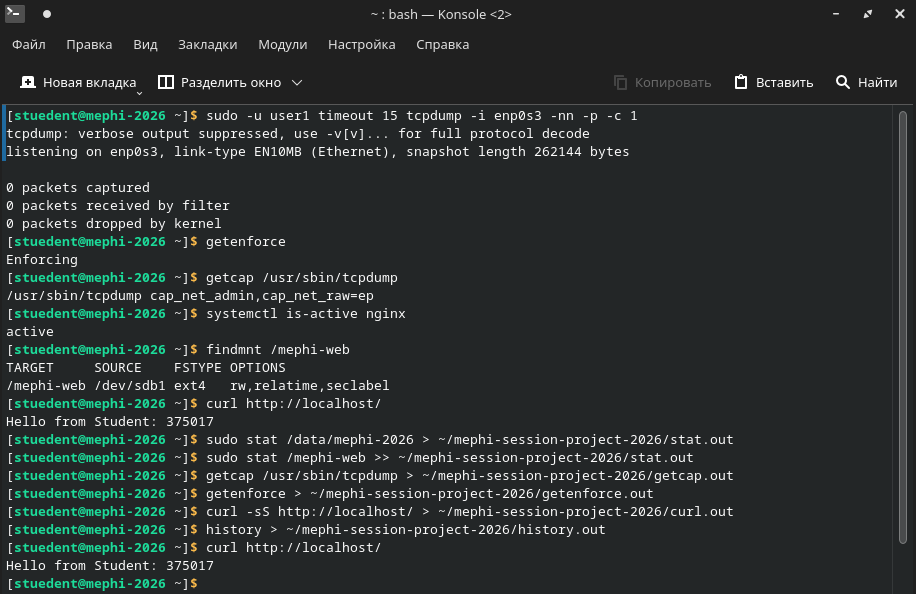

# Сессионный проект по курсу «Безопасность GNU/Linux»

Практическая настройка базовых средств защиты ОС.

- **Студент:** [Feym4n](https://github.com/Feym4n)
- **Бухгалтерский номер:** 375017
- **Система:** РЕД ОС 8, графическая установка с разрешения преподавателя
- **Виртуальная машина:** Oracle VirtualBox

## Выполнение заданий

| Раздел | Пункт | Результат |
| --- | --- | --- |
| 1. Установка | 1.1. Сеть | Интерфейс `enp0s3` получает адрес по DHCP через NAT. |
| 1. Установка | 1.2. Имя узла | `mephi-2026.domain.local`. |
| 1. Установка | 1.3. Связность | Четыре ответа от `8.8.8.8`, потерь нет. |
| 2. Пакеты | 2.1. Обновление | Выполнено обновление через DNF. |
| 2. Пакеты | 2.2. Репозитории | Установлены `nginx` и `libcap-ng-utils`. |
| 2. Пакеты | 2.3. RPM | `tcpdump.x86_64` скачан в `/tmp` и установлен командой `rpm`; повторная установка выполнена с `--replacepkgs`. |
| 3. Диски | 3.1. Раздел | На диске `/dev/sdb` размером 5 ГБ создан `/dev/sdb1`, ext4, метка `MEPHI_WEB`. |
| 3. Диски | 3.2. Монтирование | В `fstab` задано `LABEL=MEPHI_WEB /mephi-web ext4 defaults 0 2`. |
| 4. Сервисы | 4.1. nginx | Служба активна, автозапуск включён. |
| 4. Сервисы | 4.2. Журнал | Сохранены сообщения текущей загрузки. |
| 5. Доступ | 5.1. DAC | UID разработчиков: 5501–5503; GID `curators`: 4444. Для `/data/mephi-2026` настроены setgid и наследуемые ACL: разработчикам запись, кураторам чтение, остальным доступ закрыт. |
| 5. Доступ | 5.2. Capabilities | У tcpdump снят set-UID и назначены `cap_net_raw,cap_net_admin=ep`. Проверен захват пакетов от `user1`. |
| 5. Доступ | 5.3. SELinux | Режим `Enforcing`; постоянное правило `httpd_sys_content_t` для `/mephi-web(/.*)?`. Корень сайта nginx — `/mephi-web`. |
| 6. Аутентификация | 6.1. Консоль | В `/etc/pam.d/login` подключён `pam_access.so` с отдельным файлом правил. Группе `curators` отказано в текстовом входе, вход `stuedent` проверен. |
| 6. Аутентификация | 6.2. Пароли | Максимальный срок — 90 дней; минимальная длина — 12 символов, без скидок за классы символов. |
| 7. Проверка | 7.1. Страница | `/mephi-web/index.html` содержит номер 375017. |
| 7. Проверка | 7.2. HTTP | `curl http://localhost/` возвращает `Hello from Student: 375017`. |
| 8. Публикация | 8.1. Артефакты | Собраны результаты команд, системные файлы и снимок экрана. |
| 8. Публикация | 8.2–8.4. GitHub | Репозиторий для сдачи: [mephi-session-project-2026](https://github.com/Feym4n/mephi-session-project-2026). |

После перезагрузки проверены имя узла, монтирование, состояние и автозапуск nginx, SELinux, capabilities и ответ сайта.

## Артефакты

| Файл | Назначение |
| --- | --- |
| `mephi-screenshot.png` | Визуальная проверка сайта и состояния системы |
| `history.out` | История команд |
| `ping.out` | Проверка внешней связи |
| `dnf.out` | Транзакции менеджера пакетов |
| `stat.out` | Атрибуты каталогов проекта и сайта |
| `journalctl.out` | Журнал nginx |
| `getcap.out` | Привилегии tcpdump |
| `getenforce.out` | Режим SELinux |
| `curl.out` | Ответ сайта |
| `fstab` | Автоматическое монтирование |
| `passwd` | Учётные записи |
| `shadow` | Хеши паролей и параметры их старения |
| `group` | Группы |
| `pwquality.conf` | Требования к паролям |

## Скриншот выполнения задания

